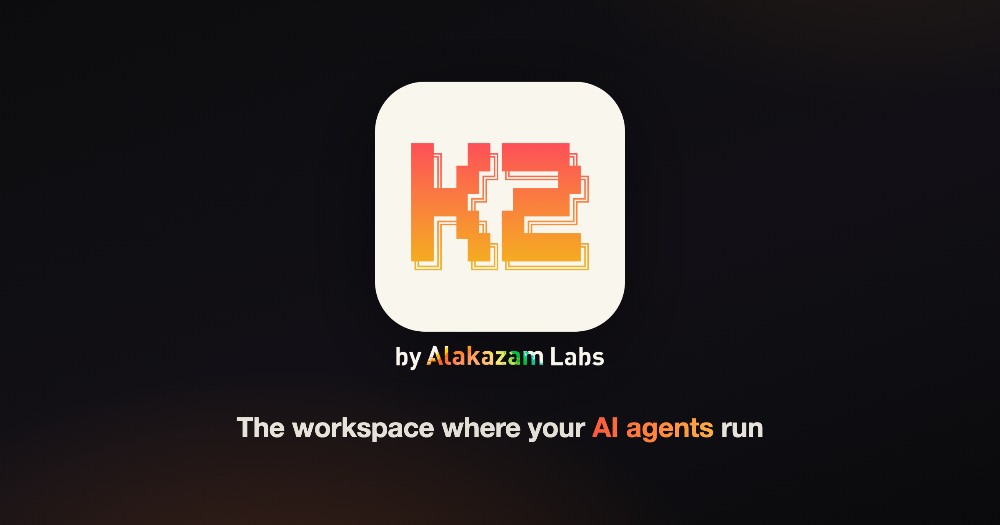

<p align="center">
  <a href="https://k2.dev">
    
  </a>
</p>

<p align="center">
  <a href="https://github.com/Alakazam-211/K2/blob/main/LICENSE.md"></a>
  <a href="https://k2.dev"></a>
  <a href="https://discord.gg/73b3sg6pSQ"></a>
  <a href="https://github.com/Alakazam-211/K2/releases"></a>
  <a href="https://github.com/Alakazam-211/K2/stargazers"></a>
  
  
</p>

<h1 align="center">K2</h1>

<p align="center">
  <strong>Multiplayer Agent Management Platform</strong><br/>
  <em>Agents as infrastructure.</em><br/>
  Host teams of agents that work together and run your business.
</p>

<p align="center">
  <a href="https://github.com/Alakazam-211/K2/releases/latest"><strong>⬇ Download</strong></a>
  &nbsp;·&nbsp;
  <a href="https://k2.dev">Website</a>
  &nbsp;·&nbsp;
  <a href="https://discord.gg/73b3sg6pSQ">Discord</a>
  &nbsp;·&nbsp;
  <a href="WHATS_NEW.md">What's New</a>
  &nbsp;·&nbsp;
  <a href="https://k2.dev/docs/api">API</a>
  &nbsp;·&nbsp;
  <a href="https://k2.dev/k2-connect">K2 Connect</a>
</p>

---

## Host an agent team, not a single agent

K2 is **agent server software** — not a traditional IDE, not a model provider.

Your agents run on **your machine** with the CLI tools you already use. They keep working when you close the window. Your team can log in, watch live, and manage the fleet from anywhere.

**Your keys. Your hardware. Full visibility.**

---

## What you get

### Agent teams on your server

Stand up a **team of agents**, not one disposable chat. Name them, house them on real projects, leave them running under a daemon that doesn’t sleep when the UI closes.

### Multiplayer — people and agents

One server is a place **your team logs into**. Presence, roles, shared live terminals, grant-the-keyboard, audit. Humans manage; agents work; everyone sees the same truth.

### Agents that work together

Agents discover each other, **message** across projects, and hand off work without you as the relay. Cross-repo collaboration becomes “tell the other agent,” not copy-paste between windows.

### Any coding agent you already pay for

Claude Code, Codex, Gemini, Copilot, Grok, Cursor, OpenCode, Goose, Pi, Hermes — **if it runs in a terminal, it runs on K2.** Bring your own subscriptions. No wrapper SDK required.

### Always-on context, one truth for every harness

Project knowledge and agent persona compile into a single always-on entrypoint every tool can read. Edit once — Claude, Codex, Cursor, and the rest stay in sync. Keep it lean; load skills when you need depth.

### Reach your machine from anywhere

**[K2 Connect](https://k2.dev/k2-connect)** tunnels your daemon to `your-name.k2.dev`. Remote workspaces, files, clone-to, multi-user access. Companion apps for phone. Same terminals, live — from the train.

### Agents as API endpoints

Build agents on K2, then **serve** them. Message a real agent from CI or cron. Spawn sandboxed sessions over HTTPS. Watch API-started work as live tabs in the app.

```bash
curl -X POST "https://your-name.k2.dev/v1/w/api/message" \
  -H "Authorization: Bearer $K2_KEY" \
  -d '{"text":"deploy when tests pass","from":"CI bot"}'
```

[API docs →](https://k2.dev/docs/api)

### Terminal-first workspace

Serious terminals, worktrees, files, review, and styles — built to manage agents, not to replace your editor of choice. Open anything in Cursor/VS Code when you want; K2 stays the control plane.

### Daemon-first (close the laptop)

Agents run against the **K2 daemon**, not the window. Shut the lid — sessions keep going. Every viewer reconnects to the same live state.

---

## Quick start

| | |
|---|---|
| **Download** | [Latest release](https://github.com/Alakazam-211/K2/releases/latest) · [All platforms](https://k2.dev/download) |
| **Product** | [k2.dev](https://k2.dev) |
| **Community** | [Discord](https://discord.gg/73b3sg6pSQ) |

### Build from source

**Prereqs:** [Rust](https://rustup.rs/) (stable), [Bun](https://bun.sh/) (or Node 18+), cmake, Xcode CLT (macOS).

```bash
git clone https://github.com/Alakazam-211/K2.git
cd K2
bun install
cargo tauri dev
```

Release: `cargo tauri build`.

---

## Under the hood

| Piece | Role |
|-------|------|
| **Daemon** | Source of truth — always on, headless-capable |
| **Desktop / web / mobile** | Thin viewers on the same server |
| **`k2` CLI** | Day-to-day surface for humans and agents |
| **New k5 command (Beta)** | The `k2` and `k5` commands as a Rust program, on macOS and Linux. Off by default: the owner turns it on in Settings → General → Server → Advanced. Not on Windows yet |
| **Stack** | Tauri v2 · React · Rust · SQLite |

Architecture map: [docs/ARCHITECTURE.md](docs/ARCHITECTURE.md).

---

## What K2 is not

- **Not an IDE replacement** — agent management infrastructure with a serious terminal UI  
- **Not a model company** — bring Claude / Codex / Gemini / … yourself  
- **Not a laptop app** — once your agents work the way you want, they perform best on a **server** that never loses internet or power. Develop and tune on your Mac; run the fleet headless where the machine stays up.

---

## How agents share a K2 server

K2 runs your agents on one server, the way hosted agent products give their agents one shared computer ([Grok Bot's works the same way](https://docs.x.ai/grok-bot/computer-and-apps): its Bots share files, sessions and command-line credentials). On a K2 server, every agent runs as the same operating-system user as K2 itself. So an agent can read what that user can read, including the server owner's credentials, and it can act with the owner's reach.

K2's permissions, cards and audit records guide what agents do and record it. They're designed for agents working on your behalf, not as walls between agents or between people who share a server. Give an agent the kind of access you'd give the server's owner. If people need to be kept apart from each other's agents, give each of them their own server. Isolation between agents is a planned update, coming soon.

What's separate today:
- **People who use K2 only through an App, as its guests,** see only what the App and their role allow. A login that can open a terminal or direct an agent isn't limited this way. The **Voice & Chat only** role can't open a terminal or use K2's agent controls, though an agent that reads its chat may still act on what such a person writes there.
- **Compute jobs on a Linux node** from different servers run as different users, each in their own folders, and can't read each other's code, caches, results or logs. They share the machine's kernel, can reach the internet and services on the machine, and the node's owner can read everything on it.

### What this means for security, and what to be careful of
- **An agent can do what the server's owner can do.** Treat any agent on the server as you would the owner's own terminal.
- **A Member login can use terminal sessions.** A Member can open and type into terminal sessions on this server, and they run as the server's own user, so a Member can reach what the owner can. Give Member, or any role above it, only to people you'd trust with the server. A later update is planned to let you give people access without terminal access.
- **Be careful what agents read.** Instructions hidden in a web page, an email, a document or another person's chat message can steer an agent, and an agent acting on them has the owner's reach. Prefer agents that only read sources you trust, and use permission cards for anything that changes access.
- **Keep secrets in K2's vault, not in files.** A plain file in a workspace is readable by every agent; the vault keeps secrets encrypted and out of the workspace, and hands them to tools without printing them.
- **Separate people, separate servers.** If people or clients mustn't see each other's work, give each of them their own K2 server rather than sharing one.
- **Check what happened.** K2's permission cards and audit records show what agents asked for and did. Review them, especially on a server several people use.

## Community

- **[Discord](https://discord.gg/73b3sg6pSQ)** — K2 community  
- **[Issues](https://github.com/Alakazam-211/K2/issues)** — bugs & features  
- **[What's New](WHATS_NEW.md)** — product highlights by version  
- **[Contributing](CONTRIBUTING.md)** — dev setup  

---

## License

[MIT](LICENSE.md), from 0.46.10 on. Releases up to 0.46.9 were FSL-1.1-Apache-2.0.

The K2 name and logo are not covered by the MIT License — see [TRADEMARKS.md](TRADEMARKS.md).

---

<p align="center">
  <sub>
    <strong>K2</strong> by Alakazam Labs ·
    <a href="https://k2.dev">k2.dev</a> ·
    <a href="https://discord.gg/73b3sg6pSQ">Discord</a> ·
    <a href="https://github.com/Alakazam-211/K2/releases/latest">Download</a>
  </sub>
</p>
